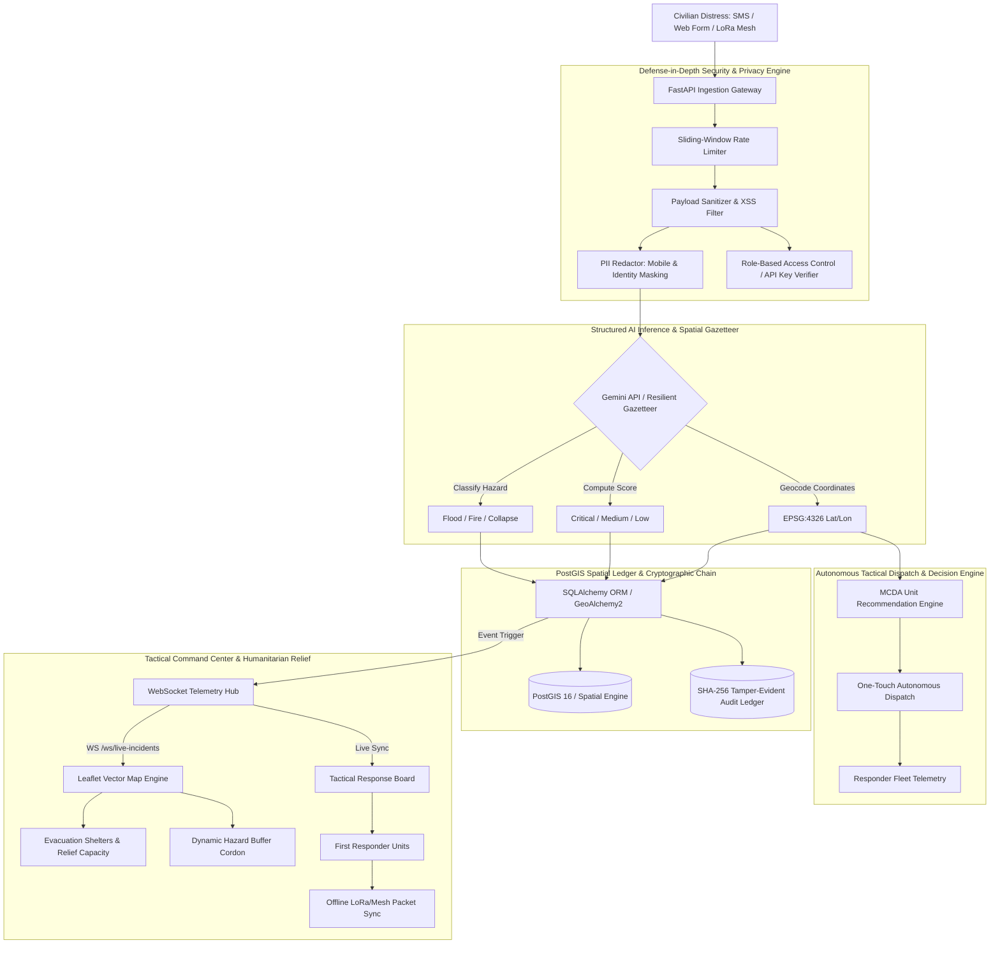

# u-SHA-jua | Sovereign Geospatial Disaster Informatics Platform

[](https://fastapi.tiangolo.com)
[](https://reactjs.org/)
[](https://postgis.net/)
[](https://leafletjs.com/)
[](server/tests)
[](server/services/security.py)
[](LICENSE)

**u-SHA-jua** is an enterprise-grade, event-driven geospatial disaster informatics platform built for resilient emergency dispatch and crisis informatics under bandwidth-constrained conditions. Designed for informal settlements and flood/fire/collapse hazard corridors across Kenya and East Africa.

---

## 1. Full System Architecture



---

## 2. Key Capabilities & Tactical Modules

### 🛡️ Enterprise Security Hardening & Vulnerability Mitigation
- **Role-Based Access Control (RBAC)**: Enforces granular role authorizations (`ROLE_DISPATCHER`, `ROLE_RESPONDER`, `ROLE_ADMIN`) via secure `X-API-Key` headers on all mutating endpoints.
- **In-Memory Sliding-Window Rate Limiting**: Token-bucket algorithm enforcing strict per-IP rate limits (60 req/min for civilian reports, 300 req/min for telecom webhooks) to prevent DoS attacks and LLM budget exhaustion.
- **Automated PII Redaction (`mask_pii`)**: Automatically detects and masks civilian mobile numbers (`+254 7XX *** *XX`) prior to broadcasting live telemetry over WebSocket feeds.
- **Input Sanitization & Script Defenses**: HTML/script injection filtering, control character stripping, and strict length bounds (up to 4000 characters) on all unstructured distress inputs.
- **Carrier-Grade Webhook Verification**: Shared secret validation (`X-Webhook-Secret`) preventing spoofing of incoming telecom SMS webhooks.
- **CORS Hardening**: Explicit origin controls eliminating dangerous wildcard credential configurations.

### ⚡ Advanced Tactical Capabilities
- **AI Multi-Criteria Decision Analysis (MCDA) Auto-Dispatch**:
  - Dynamically calculates optimal responder units (`/api/v1/responders/recommend/{id}`) evaluating unit specialty affinity (e.g., Water Rescue for Floods, Fire Engine for Fires), road transit ETA, and distance.
  - One-touch autonomous dispatch execution (`/api/v1/responders/auto-dispatch/{id}`).
- **Evacuation Shelters & Relief Capacity Registry**:
  - Real-time facility tracking (`/api/v1/shelters`) monitoring bed capacity, current occupancy, water supply status, and medical post availability.
  - Nearest open shelter calculation (`/api/v1/shelters/nearest`) with live occupancy adjustments.
- **Dynamic Hazard Perimeter & Threat Buffer Modeling**:
  - Computes 16-point circular hazard buffer polygons (`/api/v1/incidents/{id}/hazard-perimeter`) scaling with incident type and urgency.
  - Live affected civilian population estimation and automated evacuation corridor routing.
- **Cryptographic SHA-256 Tamper-Evident Audit Ledger**:
  - Immutable hash-chained audit ledger (`/api/v1/analytics/audit-log`) recording all distress reports, dispatch orders, status changes, and operator actions.
  - Full cryptographic chain verification endpoint (`/api/v1/analytics/audit-log/verify`).
- **Offline Crisis Mesh Synchronization & Portable Bundles**:
  - Ingestion endpoint (`/api/v1/incidents/sync/offline-packet`) for distress packets collected during cellular blackouts via LoRa, Bluetooth, or ad-hoc Wi-Fi.
  - Portable JSON crisis package export (`/api/v1/incidents/export/offline-bundle`) for field tablet deployments.
- **High-Density GIS Command Dashboard**:
  - Leaflet vector map with live pulse clusters, weather radar HUD, evacuation shelter markers, active responder routes, and dynamic hazard cordons.
  - Integrated Enterprise Tactical Command & Security Suite modal.

---

## 3. Directory Layout

```text
├── .antigravity/
│   └── config.yaml            # Antigravity CLI project config
├── docker-compose.yml         # PostGIS, Backend, and Frontend composition
├── PLAN.md                    # System implementation & phase blueprint
├── server/                    # Python 3.10/3.11 FastAPI Backend
│   ├── config.py              # Environment configuration & security keys
│   ├── database.py            # PostGIS & SQLite dual-mode DB engine
│   ├── main.py                # Application entrypoint & table seeding
│   ├── Dockerfile             # Container specification
│   ├── requirements.txt       # Dependencies
│   ├── models/                # SQLAlchemy models (Incident, Responder, Shelter)
│   ├── schemas/               # Pydantic v2 validation & sanitization schemas
│   ├── services/              # Gemini NLP, Spatial Index, WebSockets, Security & Audit
│   │   ├── security.py        # RBAC, Rate Limiting, PII Masking, Input Sanitization
│   │   ├── audit_service.py   # SHA-256 Tamper-Evident Cryptographic Ledger
│   │   ├── nlp_service.py     # Gemini NLP with offline East African gazetteer
│   │   ├── spatial_index.py   # 2D in-memory spatial grid & LRU cache
│   │   └── websocket_manager.py# High-concurrency async broadcast hub
│   ├── routers/               # Incidents, Responders, Shelters, SMS, Weather, Analytics
│   └── tests/                 # Automated Pytest suite (28 comprehensive tests)
├── client/                    # Vite + React 18 + TypeScript + Leaflet Frontend
│   ├── src/
│   │   ├── components/        # Map, DispatchBoard, CommandCenterModal, Header, etc.
│   │   ├── services/          # REST & WebSocket API clients with auth headers
│   │   ├── types/             # TypeScript interfaces & GeoJSON definitions
│   │   ├── App.tsx            # Main tactical GIS operations viewport
│   │   └── main.tsx           # Application bootstrap
│   └── Dockerfile             # Frontend Nginx production container
└── scripts/
    └── load_test.py           # Concurrency & latency percentile benchmark
```

---

## 4. Quickstart Guide

### 1. Backend (FastAPI)
```bash
cd server
pip install -r requirements.txt
python main.py
```
*API interactive documentation available at [http://localhost:8000/docs](http://localhost:8000/docs)*

### 2. Frontend (React + Vite)
```bash
cd client
npm install
npm run dev
```
*Access GIS Command Center at [http://localhost:5173](http://localhost:5173)*

### 3. Docker Compose (Full Stack with PostGIS)
```bash
docker compose up -d --build
```

---

## 5. API Reference

| Method | Endpoint | Access Tier | Description |
|---|---|---|---|
| `POST` | `/api/v1/incidents/report` | Public (Rate-Limited) | Ingests civilian raw distress report, runs AI geocoding & broadcasts update |
| `POST` | `/api/v1/incidents/batch-report` | Public (Rate-Limited) | High-throughput batch ingestion for telecom aggregators (400+ reports/sec) |
| `POST` | `/api/v1/sms/incoming` | Carrier Secret | Africa's Talking / Twilio incoming SMS webhook (<50ms carrier SLA) |
| `GET` | `/api/v1/incidents/spatial-feed` | Public | GeoJSON FeatureCollection bounded by viewport with sub-millisecond LRU cache |
| `GET` | `/api/v1/incidents/track/{id}` | Public | Civilian 4-stage rescue tracking timeline with assigned unit telemetry |
| `GET` | `/api/v1/incidents/{id}/hazard-perimeter` | Public | Dynamic circular hazard buffer polygon and affected population modeling |
| `POST` | `/api/v1/incidents/sync/offline-packet` | Public | Ingests offline mesh distress packets from field LoRa/Bluetooth nodes |
| `GET` | `/api/v1/incidents/export/offline-bundle` | Public | Exports portable JSON crisis bundle for disconnected field tablets |
| `GET` | `/api/v1/responders/recommend/{id}` | Public / Dispatcher | MCDA scoring engine matching optimal responder units to crisis type |
| `POST` | `/api/v1/responders/auto-dispatch/{id}` | Dispatcher / Admin | One-touch autonomous dispatch execution |
| `POST` | `/api/v1/responders/{id}/dispatch` | Dispatcher / Admin | Dispatches specific responder unit and broadcasts synchronized routing |
| `PATCH` | `/api/v1/responders/{id}/location` | Responder / Admin | Live field GPS coordinates update and telemetry broadcast |
| `GET` | `/api/v1/shelters` | Public | Lists all designated emergency evacuation shelters with capacity status |
| `GET` | `/api/v1/shelters/nearest` | Public | Calculates closest operational shelter with available bed space |
| `PATCH` | `/api/v1/shelters/{id}/occupancy` | Dispatcher / Admin | Updates real-time shelter occupancy count |
| `GET` | `/api/v1/analytics/audit-log` | Dispatcher / Admin | Retrieves immutable SHA-256 operational event audit trail |
| `GET` | `/api/v1/analytics/audit-log/verify` | Dispatcher / Admin | Validates cryptographic integrity across all historical audit blocks |
| `WS` | `/ws/live-incidents` | Public | Real-time WebSocket event stream with channel subscriptions |
| `GET` | `/health` | Public | System health check reporting active connections and audit verification |

---

## 6. Verification & Automated Test Suite

The platform includes 28 automated integration and security unit tests with 100% pass rate:

```bash
cd server
pytest -v
```

### Verified Test Modules:
- `tests/test_security_and_advanced.py`: Rate limiting, PII masking, input sanitization, SHA-256 audit ledger integrity, shelters API, MCDA recommendation, hazard perimeters, and offline mesh sync.
- `tests/test_features.py`: Civilian distress tracking, weather telemetry, and flood polygon endpoints.
- `tests/test_incidents.py`: Ingestion pipelines, coordinate bounds, and spatial GeoJSON format.
- `tests/test_responders.py`: Distance/ETA calculations, dispatch synchronization, and status progression.
- `tests/test_scaling.py`: Concurrency scaling, spatial grid indexing, and LRU cache hit rate.

---

## 7. License
Apache License 2.0. Built for sovereign humanitarian crisis resilience and community disaster informatics.
