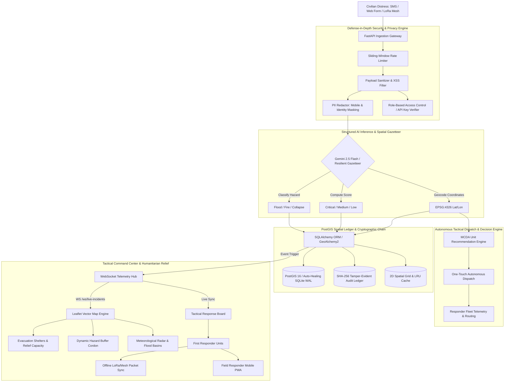

# u-SHA-jua | Sovereign Geospatial Disaster Informatics Platform

[](https://fastapi.tiangolo.com)
[](https://reactjs.org/)
[](https://www.typescriptlang.org/)
[](https://postgis.net/)
[](https://leafletjs.com/)
[](server/tests)
[](server/services/security.py)
[](LICENSE)

**u-SHA-jua** (*"You already know"* in Swahili) is an enterprise-grade, event-driven geospatial disaster informatics platform built for resilient emergency dispatch and crisis informatics under bandwidth-constrained conditions. Designed for informal settlements and flood/fire/collapse hazard corridors across Kenya and East Africa (Mathare, Kibera, Mukuru, Gikomba, Eastleigh, Pipeline, and the Nairobi Basin).

> **AI & Developer Context Blueprint**: This README contains the complete, end-to-end architectural, algorithmic, data-model, API, WebSocket, and UI component specification of the **u-SHA-jua** platform (`v1.3.0-enterprise`) so any engineer or AI coding assistant (Claude, Antigravity, Cursor) can immediately understand and extend any subsystem without ambiguity.

---

## 1. Full System Architecture



### Core Data Models & Persistence Schema (`server/models/` & `server/database.py`)
The backend operates seamlessly across **PostgreSQL 16 + PostGIS 3.4** (`pool_size=20`, `max_overflow=40`, `pool_pre_ping=True`, `Geometry('POINT', srid=4326)`) and **Auto-Healing SQLite WAL** (`PRAGMA journal_mode=WAL`, `PRAGMA synchronous=NORMAL`, `PRAGMA busy_timeout=30000`).

1. **`Incident` (`incidents` table — `server/models/incident.py`)**:
   - `id`: `String(36)` UUIDv4 Primary Key.
   - `raw_text`: `Text` (sanitized unstructured distress message, max 4,000 chars).
   - `incident_type`: `Enum(IncidentType)` -> `"Flood"` | `"Fire"` | `"Collapse"` (indexed).
   - `urgency_level`: `Enum(UrgencyLevel)` -> `"Low"` | `"Medium"` | `"Critical"` (indexed).
   - `location_name`: `String(255)` (resolved landmark or GPS pin label).
   - `latitude` & `longitude`: `Float` in EPSG:4326 (composite index `idx_incidents_lat_lon`).
   - `coordinates`: Optional PostGIS `Geometry('POINT', srid=4326)` when running on PostgreSQL.
   - `status`: `Enum(IncidentStatus)` -> `"Pending"` | `"Dispatched"` | `"Resolved"` (composite index `idx_incidents_status_urgency_ts`).
   - `timestamp`: `DateTime` UTC (indexed descending via `idx_incidents_ts_desc`).
   - Helper methods: `to_dict()` (JSON with nested `coordinates: {latitude, longitude}`) and `to_geojson_feature()` (GeoJSON `Feature` with `Point` `[longitude, latitude]`).
   - **Initial Seed Data**: Automatically seeds 6 realistic Nairobi incidents on empty DB startup (Mathare Valley 4A Flood, Gikomba Market Fire, Mukuru kwa Njenga Wall Collapse, Kibera Olympic Flood, Eastleigh Section 3 Transformer Fire, Pipeline Estate Structural Cracks).

2. **`ResponderUnit` (`responder_units` table — `server/models/responder.py`)**:
   - `id`: `String(36)` UUIDv4 Primary Key.
   - `callsign`: `String(64)` Unique (e.g., `"AMB-01 (Red Cross EOC)"`).
   - `unit_type`: `Enum(ResponderType)` -> `"Ambulance"` | `"FireEngine"` | `"WaterRescue"` | `"SearchRescue"`.
   - `base_station`: `String(128)` (physical station name).
   - `latitude` & `longitude`: `Float` live GPS coordinates.
   - `status`: `Enum(ResponderStatus)` -> `"Available"` | `"Dispatched"` | `"OnScene"` | `"Returning"`.
   - `assigned_incident_id`: `String(36)` nullable foreign reference to `incidents.id`.
   - **Initial Seed Fleet (`DEFAULT_FLEET`)**: 6 tactical units across Nairobi (`AMB-01` South C, `FIRE-01` Tom Mboya St, `RESCUE-01` Mathare Juja Rd, `AMB-02` Parliament Rd, `FIRE-02` Industrial Area, `SAR-03` Nyayo House).

3. **`Shelter` (`evacuation_shelters` table — `server/models/shelter.py`)**:
   - `id`: `String(36)` UUIDv4 Primary Key.
   - `name` (`String(128)`), `location_name` (`String(128)`), `latitude` (`Float`), `longitude` (`Float`).
   - `capacity_total` (`Integer`), `occupancy_current` (`Integer`), computed `available_space` (`max(0, capacity_total - occupancy_current)`) and `occupancy_percent`.
   - `water_supply_status` (`String(32)`: `"Operational"` | `"Constrained"`), `medical_post_available` (`Boolean`), `contact_phone` (`String(32)`), `is_active` (`Boolean`).
   - **Initial Seed Shelters (`DEFAULT_SHELTERS`)**: 5 relief centers (Mathare Drive Community Relief Hall, Pumwani Social Center, Olympic High Ground Disaster Shelter, Kwa Njenga Elevated Vocational Shelter, Jamhuri Park National Relief Base).

---

## 2. Key Capabilities & Tactical Modules

### 🛡️ Enterprise Security Hardening & Vulnerability Mitigation (`server/services/security.py`)
- **Role-Based Access Control (RBAC)**: Enforces granular role authorizations (`ROLE_DISPATCHER = "dispatcher"`, `ROLE_RESPONDER = "responder"`, `ROLE_ADMIN = "admin"`) via `X-API-Key` headers using the `verify_api_key(required_roles)` dependency. In development (`ENVIRONMENT=development` and `ENFORCE_STRICT_AUTH=false`), unauthenticated requests default permissively to `ROLE_ADMIN` for frictionless local testing; setting `ENFORCE_STRICT_AUTH=true` strictly rejects missing or unauthorized keys with `HTTP 401`/`403`.
- **In-Memory Sliding-Window Rate Limiting (`InMemoryRateLimiter`)**: Thread-safe per-IP sliding window (`check_rate_limit`) inspecting `X-Forwarded-For` and client host IPs. Enforces **60 req/min** on `/api/v1/incidents/report`, **120 req/min** on `/api/v1/incidents/batch-report`, and **300 req/min** on `/api/v1/sms/incoming`, returning `HTTP 429 Too Many Requests` with `Retry-After` headers and auto-purging stale IP buckets every 200 requests.
- **Automated PII Redaction (`mask_pii`)**: Regex filter (`(\+?254|0)?\s?([17]\d{2})\s?(\d{3})\s?(\d{3})`) that automatically masks Kenyan mobile numbers into `+254 7XX *** *XX` format before broadcasting incident text or logging sender metadata to WebSocket feeds.
- **Input Sanitization & Script Defenses (`sanitize_input` / `clean_script_tags`)**: Strips `<script>...</script>` blocks, HTML tags, null bytes, and non-printable ASCII control characters while enforcing strict character length bounds (`max_len=4000`).
- **Carrier-Grade Webhook Verification**: Validates `X-Webhook-Secret` header or `?secret=` query param against `SMS_WEBHOOK_SECRET` on telecom webhook endpoints.
- **CORS & Compression Hardening**: Explicit origin whitelist (`localhost:5173`, `localhost:3000`, `localhost:8000`) plus `GZipMiddleware(minimum_size=500)` for low-bandwidth cellular links.

### 🧠 Resilient AI NLP Extraction & East African Gazetteer (`server/services/nlp_service.py`)
- **4-Stage Inference Pipeline (`extract_distress_report`)**:
  1. **Normalized In-Memory LRU Cache (`NLPExtractionCache`)**: Thread-safe `OrderedDict` (`maxsize=4096`) keyed by normalized lowercase text + quantized `lat|lon` (`<0.05ms` lookup).
  2. **Gemini 2.5 Flash Structured Extraction**: Calls `gemini-2.5-flash` asynchronously wrapped in `asyncio.wait_for(..., timeout=2.0)` to extract `incident_type`, `urgency_level`, `location_name`, `estimated_lat`, `estimated_lon`, and `confidence`.
  3. **Automatic Circuit Breaker**: Trips open for **60 seconds** immediately upon HTTP `429` / quota exhaustion, or for **30 seconds** after 3 consecutive network/API failures.
  4. **Deterministic Local Fallback (`_extract_fallback`)**: Bilingual English/Swahili keyword classifier (`moto`, `choma`, `smoke`, `blaze` -> `Fire`; `anguka`, `collapse`, `debris`, `cracked`, `landslide` -> `Collapse`; `mafuriko`, `mvua`, `flood`, `submerged`, `swept` -> `Flood`) + urgency scoring (`trapped`, `dying`, `children trapped`, `swept away`, `flash flood` -> `Critical`; `puddles`, `small smoke`, `minor cracks` -> `Low`; default `Medium`) + offline geocoding against `KENYA_GAZETTEER` (22 major settlements across Nairobi, Busia/Budalangi, Kisumu, Mombasa, Garissa, Nakuru, and Eldoret, defaulting to Nairobi Central `-1.286389, 36.817223`). Honors `device_lat`/`device_lon` GPS coordinates whenever supplied.

### ⚡ AI Multi-Criteria Decision Analysis (MCDA) Auto-Dispatch (`server/routers/responders.py`)
- **Haversine Distance & Turnout ETA**: Computes spherical distance $d_{\text{km}}$ (`R = 6371.0 km`) and road transit ETA:
  $$\text{ETA}_{\text{min}} = \max\left(3,\ \text{round}\left(\frac{d_{\text{km}}}{32.0\text{ km/h}} \times 60 + 3.0\right)\right)$$
- **Dynamic Unit Recommendation (`/api/v1/responders/recommend/{id}`)**: Scores every responder unit on a 100-point scale (`clamped to [10.0, 100.0]`):
  - **Specialty Affinity (40 pts max)**: Uses `AFFINITY_MATRIX`:
    - `Flood`: `WaterRescue` (1.0), `SearchRescue` (0.85), `Ambulance` (0.80), `FireEngine` (0.40)
    - `Fire`: `FireEngine` (1.0), `Ambulance` (0.85), `SearchRescue` (0.65), `WaterRescue` (0.50)
    - `Collapse`: `SearchRescue` (1.0), `Ambulance` (0.90), `FireEngine` (0.70), `WaterRescue` (0.30)
  - **Proximity & ETA Decay (45 pts max)**: $\max(0.0,\ 45.0 - 3.75 \times d_{\text{km}})$ (linear decay over 12 km).
  - **Operational Availability (15 pts max)**: `15.0` if `status == "Available"`, else `0.0`.
- **One-Touch Autonomous Dispatch (`/api/v1/responders/auto-dispatch/{id}`)**: Selects `best_match` from the MCDA engine, assigns the unit to the incident, transitions both unit and incident to `Dispatched`, invalidates spatial caches, records a cryptographic audit entry, and broadcasts `responder_dispatched` (with `[lon, lat]` routing origin/destination, distance, and ETA) + `status_updated` over WebSockets.
- **Crisis Surge Stress-Test Simulator (`/api/v1/responders/surge-simulate`)**: Injects 1 to 6 realistic emergency distress calls across Nairobi hotspots concurrently to test command center triage under surge load.

### 🏛️ Designated Evacuation Shelters & Relief Capacity (`server/routers/shelters.py`)
- **Real-Time Facility Registry (`/api/v1/shelters`)**: Monitors total bed capacity, current occupancy, available bed count, occupancy percentage, water supply status, and medical post availability (supports `?only_with_capacity=true`).
- **Nearest Operational Shelter Calculation (`/api/v1/shelters/nearest`)**: Evaluates Haversine distance from any `(latitude, longitude)` and sorts by `(available_space <= 0, distance_km)` so open shelters with remaining capacity are always prioritized.
- **Live Occupancy Adjustment (`PATCH /api/v1/shelters/{id}/occupancy`)**: Updates `occupancy_current`, logs `SHELTER_OCCUPANCY_UPDATED` to the audit trail, and broadcasts `shelter_updated` to all connected clients.

### 🌐 Dynamic Hazard Buffer Perimeters & Population Modeling (`server/routers/incidents.py`)
- **Circular Hazard Buffer Generation (`/api/v1/incidents/{id}/hazard-perimeter`)**: Computes a 16-point closed GeoJSON `Polygon` around the incident epicenter using latitude/longitude degree conversion (`111,320m` per degree latitude, cosine-adjusted for longitude).
  - **Dynamic Radius Scaling**:
    - `Critical`: **950m** (`Flood`), **700m** (`Fire`), **500m** (`Collapse`)
    - `Medium`: **400m** (all hazard types)
    - `Low`: **200m** (all hazard types)
- **Population Impact & Evacuation Advisory**: Computes circular area $A = \pi r^2$ and estimates impacted population in high-density informal settlements via $\text{Pop} = \lfloor (A / 10000) \times 850 \rfloor$, automatically linking the closest active evacuation shelter and generating an actionable evacuation cordon directive.

### 🔒 Cryptographic SHA-256 Tamper-Evident Audit Ledger (`server/services/audit_service.py`)
- **Immutable Hash-Chained Audit Trail (`/api/v1/analytics/audit-log`)**: Initializes with Genesis Block `0` (`timestamp="2026-10-15T00:00:00Z"`, `previous_hash="0"*64`, `action="SYSTEM_INIT"`). Every operational mutation (`INCIDENT_REPORTED`, `BATCH_INCIDENTS_REPORTED`, `MANUAL_INCIDENT_CREATED`, `INCIDENT_STATUS_CHANGED`, `INCIDENT_DELETED`, `SMS_INCIDENT_INGESTED`, `RESPONDER_DISPATCHED`, `RESPONDER_STATUS_CHANGED`, `CRISIS_SURGE_SIMULATED`, `SHELTER_OCCUPANCY_UPDATED`, `OFFLINE_PACKET_SYNCED`) appends a thread-safe block with deterministic SHA-256 digest:
  $$\text{Hash}_i = \text{SHA256}\left(\texttt{"\{entry\_id\}|\{timestamp\}|\{action\}|\{actor\}|\{json\_sorted\_details\}|\{prev\_hash\}"}\right)$$
- **One-Click Cryptographic Verification (`/api/v1/analytics/audit-log/verify`)**: Recomputes and verifies every block hash and `previous_hash` pointer from Block `0` to the tip, reporting `valid: true/false`, `total_blocks`, `latest_hash`, and exact `error_at_block` if tampered.

### 📡 Offline Crisis Mesh Synchronization & Portable Bundles (`server/routers/incidents.py`)
- **Mesh Packet Ingestion (`/api/v1/incidents/sync/offline-packet`)**: Accepts `OfflinePacketSyncRequest` (`device_id`, `packet_timestamp`, `incidents[]`) collected during cellular blackouts via LoRa, Bluetooth, or Wi-Fi mesh relays. Deduplicates by incident UUID, inserts new records, updates the in-memory spatial grid, and logs `OFFLINE_PACKET_SYNCED`.
- **Portable Crisis Bundle Export (`/api/v1/incidents/export/offline-bundle`)**: Exports a self-contained `1.3.0-mesh` JSON snapshot containing all unresolved incidents, active evacuation shelters, and the latest SHA-256 audit ledger checksum (`security_checksum`) for disconnected field tablets.

### 📱 Frontend Tactical GIS Operations Center & Modals (`client/src/`)
The React 18 + TypeScript + Tailwind CSS frontend (`App.tsx`) provides a dark-ops command interface (`#0B0F17`) with synthesized Web Audio API critical alarm tones (`880Hz -> 440Hz` sawtooth ramp on `Critical` incoming events) and `Escape`-key modal dismissal:
- **`Header.tsx`**: Live WebSocket connection indicator, active critical incident counter badge, Low-Bandwidth 2G/3G mode toggle, Audio Alert mute/unmute toggle, and quick-launch buttons for all 6 operational modals.
- **`StatCards.tsx`**: Real-time HUD cards displaying Total Incidents, Critical Emergencies, Pending Triage, Dispatched Units, and Resolved Operations.
- **`DisasterMap.tsx`**: Interactive Leaflet vector map featuring:
  - 4 switchable basemaps (CARTO Dark Matter, CARTO Positron, OpenStreetMap Standard, Esri World Imagery Satellite).
  - Urgency-styled pulsing markers (Red pulsing for `Critical`, Orange for `Medium`, Yellow for `Low`, Green for `Resolved`).
  - Toggleable GIS overlay layers: **Flood Risk Polygons** (`/api/v1/weather/flood-zones`), **Urgency Heatmap Circles**, **Evacuation Shelters** (`/api/v1/shelters`), **Dynamic Hazard Perimeter Cordon** (`/api/v1/incidents/{id}/hazard-perimeter`), **Responder Fleet Markers**, and **Animated Dashed Dispatch Route Polylines** (`ActiveRoute`).
  - Live Weather Radar HUD widget displaying rainfall (`mm/h`), river gauge height (`m`), wind speed, and Kenya Met Dept flash flood bulletins.
- **`DispatchBoard.tsx`**: Right-hand tactical triage panel with search, hazard type filter (`All`, `Flood`, `Fire`, `Collapse`), urgency filter (`All`, `Critical`, `Medium`, `Low`), status filter, AI MCDA unit recommendation preview, one-click **Auto-Dispatch**, and status transition buttons (`Pending` -> `Dispatched` -> `Resolved`).
- **`ResponderFleet.tsx`**: Bottom fleet matrix bar displaying all 6 responder units, their base stations, live status badges (`Available`, `Dispatched`, `OnScene`, `Returning`), distance/ETA to the currently selected incident, and direct dispatch/reset controls.
- **`ReportModal.tsx`**: Operator quick-report dialog for submitting distress messages with preset scenario templates and optional GPS coordinates.
- **`CivilianPortalModal.tsx`**: Two-tab public citizen portal:
  - *Report Emergency Tab*: HTML5 `navigator.geolocation` GPS lock, situational quick-tags (`Trapped on Rooftop`, `Rising Water`, `Children/Elderly`, `Medical Injury`, `Power Line Down`, `Wall Collapse`), simulated photo attachment, in-browser voice note recording timer, and instant tracking code generation.
  - *Track Rescue Tab*: Live 4-stage progress tracker (`/api/v1/incidents/track/{id}`) showing assigned responder unit callsign, base station, and stage completion.
- **`ResponderPwaModal.tsx`**: Dedicated mobile-viewport cockpit for field operatives with unit selector, active mission target card, turn-by-turn navigation cues, interactive 4-item On-Scene Safety & Triage Checklist, live GPS ping broadcast (`PATCH /api/v1/responders/{id}/location`), and one-tap status progression (`En Route` -> `On Scene` -> `Resolved & Clear`).
- **`AnalyticsModal.tsx`**: Executive KPI dashboard (`/api/v1/analytics/summary`) displaying Resolution Rate, MTTD (`4.2m`), MTTR (`18.5m`), Estimated Affected Civilians, Hazard & Urgency distribution bars, Top 5 Hotspot Neighborhood rankings, and one-click CSV dataset download (`/api/v1/analytics/export/csv`).
- **`SimulatorModal.tsx`**: Crisis stress-test console triggering `/api/v1/responders/surge-simulate` (1–6 simultaneous multi-hazard incidents) or high-throughput batch ingestion (`/api/v1/incidents/batch-report`).
- **`CommandCenterModal.tsx`**: 4-tab Enterprise Command & Security Suite:
  - *AI Auto-Dispatch (MCDA)*: Inspects full MCDA unit scoring breakdown and triggers one-touch autonomous dispatch.
  - *Evacuation Shelters*: Monitors live shelter occupancy bars and provides `+25` / `-25` real-time headcount adjustment buttons.
  - *SHA-256 Audit Ledger*: Displays hash-chained operational blocks (`entry_hash`, `previous_hash`, `actor`, `action`) with one-click cryptographic chain verification.
  - *Offline Mesh & RBAC*: Configures client `X-API-Key` role credentials (`Dispatcher`, `Responder`, `Admin`), simulates LoRa/Bluetooth offline mesh packet synchronization, and downloads portable crisis JSON bundles.

### ⚡ High-Throughput Spatial Indexing & WebSocket Hub (`server/services/`)
- **In-Memory 2D `SpatialGridIndex` & `SpatialLRUCache` (`spatial_index.py`)**:
  - Partitions the globe into `0.02° × 0.02°` (~2.2 km) grid cells for $O(1)$ bucket lookup on bounding-box queries.
  - Wraps viewport responses in a quantized `0.01°` (~1.1 km) `SpatialLRUCache` (`maxsize=4096`, `TTL=30s`) that automatically invalidates on any incident mutation.
- **High-Concurrency `WebSocketManager` (`websocket_manager.py`)**:
  - Broadcasts concurrently to all connected clients via `asyncio.gather` with a strict `1.5s` per-socket timeout (`asyncio.wait_for`), automatically pruning slow or dead connections to eliminate head-of-line blocking.
  - Supports client-side channel filtering (`{"action": "subscribe", "channels": ["all" | "critical"]}`), spatial viewport bounding-box filtering (`{"action": "set_viewport", "bbox": {"min_lat", "max_lat", "min_lon", "max_lon"}}`), and `ping`/`pong` keepalive heartbeats.

---

## 3. Directory Layout

```text
├── .antigravity/
│   └── config.yaml            # Antigravity CLI project config
├── docker-compose.yml         # PostGIS 16, FastAPI Backend, and Vite Frontend composition
├── PLAN.md                    # System implementation & phase blueprint (Phases 1-7)
├── README.md                  # Complete system architecture, specs, and documentation
├── scripts/
│   └── load_test.py           # Async concurrency & latency percentile benchmark (50+ RPS)
├── server/                    # Python 3.10/3.11 FastAPI Backend (v1.3.0-enterprise)
│   ├── config.py              # Environment configuration, RBAC keys, & CORS origins
│   ├── database.py            # PostGIS connection pool & auto-healing SQLite WAL engine
│   ├── main.py                # Application entrypoint, lifespan, GZip, & initial DB seeding
│   ├── Dockerfile             # Backend container specification
│   ├── requirements.txt       # Python dependencies (FastAPI, SQLAlchemy, GeoAlchemy2, Gemini, Pytest)
│   ├── models/                # SQLAlchemy ORM models
│   │   ├── __init__.py        # Model exports
│   │   ├── incident.py        # Incident entity (Flood/Fire/Collapse, Low/Medium/Critical, EPSG:4326)
│   │   ├── responder.py       # ResponderUnit entity (Ambulance/FireEngine/WaterRescue/SearchRescue)
│   │   └── shelter.py         # Shelter entity (capacity, occupancy, water, medical post)
│   ├── schemas/               # Pydantic v2 validation & sanitization schemas
│   │   ├── __init__.py        # Schema exports
│   │   ├── incident.py        # Incident request/response, batch, offline sync, & GeoJSON schemas
│   │   └── responder.py       # Responder fleet, dispatch assignment, & surge simulation schemas
│   ├── services/              # Core domain services & tactical modules
│   │   ├── __init__.py        # Service exports
│   │   ├── audit_service.py   # SHA-256 Tamper-Evident Cryptographic Audit Ledger
│   │   ├── nlp_service.py     # Gemini 2.5 Flash NLP with circuit breaker & 22-location Kenya gazetteer
│   │   ├── security.py        # RBAC API Key verifier, Sliding-Window Rate Limiter, PII Masking, XSS Sanitizer
│   │   ├── spatial_index.py   # 2D in-memory SpatialGridIndex (0.02°) & SpatialLRUCache (0.01°, 30s TTL)
│   │   └── websocket_manager.py # Async parallel WebSocket broadcast hub with viewport & channel filtering
│   ├── routers/               # Modular API endpoint routers
│   │   ├── __init__.py        # Router exports
│   │   ├── analytics.py       # KPI summary, CSV export, & SHA-256 audit log retrieval/verification
│   │   ├── incidents.py       # Ingestion, batch report, GeoJSON spatial feed, tracking, hazard buffer, mesh sync
│   │   ├── responders.py      # Fleet tracking, Haversine ETA, MCDA recommendation, auto-dispatch, surge sim
│   │   ├── shelters.py        # Evacuation shelter registry, nearest shelter search, & occupancy updates
│   │   ├── sms.py             # Telecom SMS webhooks (Africa's Talking / Twilio form & JSON payloads)
│   │   ├── weather.py         # Meteorological telemetry HUD & 4 Nairobi flood plain GeoJSON polygons
│   │   └── ws.py              # Real-time WebSocket endpoint (/ws/live-incidents)
│   └── tests/                 # Automated Pytest suite (28 comprehensive tests)
│       ├── test_features.py   # Tracking, weather telemetry, & flood polygons
│       ├── test_incidents.py  # Ingestion pipelines & spatial GeoJSON validation
│       ├── test_responders.py # Distance/ETA calculations & dispatch progression
│       ├── test_scaling.py    # In-memory spatial index, LRU cache, & batch ingestion
│       └── test_security_and_advanced.py # RBAC, rate limiter, PII, MCDA, shelters, hazard buffer, & audit ledger
└── client/                    # Vite + React 18 + TypeScript + Tailwind CSS + Leaflet Frontend
    ├── src/
    │   ├── components/        # Tactical UI & Operations Center Modals
    │   │   ├── AnalyticsModal.tsx      # Operational KPI metrics, hotspot bars, & CSV export
    │   │   ├── CivilianPortalModal.tsx # Public distress reporting (GPS/tags/voice) & 4-stage rescue tracker
    │   │   ├── CommandCenterModal.tsx  # 4-tab Enterprise Suite (MCDA, Shelters, Audit Ledger, Mesh/RBAC)
    │   │   ├── DisasterMap.tsx         # Leaflet vector map, 4 basemaps, flood zones, shelters, & hazard cordons
    │   │   ├── DispatchBoard.tsx       # Incident triage, filters, MCDA preview, & one-touch dispatch controls
    │   │   ├── Header.tsx              # Telemetry bar, status badges, audio/bandwidth toggles, & modal launchers
    │   │   ├── ReportModal.tsx         # Operator quick incident reporting modal with presets
    │   │   ├── ResponderFleet.tsx      # Bottom fleet status matrix & proximity/ETA monitors
    │   │   ├── ResponderPwaModal.tsx   # Mobile PWA for field agents, navigation cues, & scene checklist
    │   │   ├── SimulatorModal.tsx      # Crisis surge & batch stress-test simulator console
    │   │   └── StatCards.tsx           # High-visibility operational HUD metric cards
    │   ├── services/          # REST & WebSocket API clients with RBAC auth headers
    │   │   └── api.ts         # Fetch wrappers, X-API-Key manager, & auto-reconnecting WebSocket client
    │   ├── types/             # TypeScript interfaces & GeoJSON definitions
    │   │   └── index.ts       # Complete shared data models, enums, & response contracts
    │   ├── App.tsx            # Main tactical GIS operations viewport & WebSocket event orchestrator
    │   ├── index.css          # Tailwind CSS styling & custom animations
    │   └── main.tsx           # Application bootstrap
    ├── index.html             # HTML entry point with Leaflet CSS
    ├── package.json           # Frontend dependencies
    ├── tsconfig.json          # TypeScript compiler configuration
    ├── vite.config.ts         # Vite bundler configuration
    └── Dockerfile             # Production multi-stage Node build + Nginx container specification
```

---

## 4. Quickstart Guide

### Prerequisites
- Python 3.10 or 3.11
- Node.js 18+ and npm
- (Optional) Docker & Docker Compose for PostgreSQL 16 / PostGIS 3.4

### 1. Environment Configuration
Create a `.env` file in the `server/` directory:
```env
PROJECT_NAME="u-SHA-jua Disaster Informatics Platform"
DATABASE_URL=sqlite:///./ushajua.db
ENVIRONMENT=development
HOST=127.0.0.1
PORT=8000

# Security & API Keys
ENFORCE_STRICT_AUTH=false
DISPATCHER_API_KEY=ushajua-dev-dispatcher-key
RESPONDER_API_KEY=ushajua-dev-responder-key
ADMIN_API_KEY=ushajua-dev-admin-key
SMS_WEBHOOK_SECRET=ushajua-telecom-secret

# External Services (Optional - system automatically uses deterministic Kenya Gazetteer if omitted)
GEMINI_API_KEY=your_gemini_api_key_here
MAPBOX_ACCESS_TOKEN=your_mapbox_token_here
AFRICASTALKING_API_KEY=your_africastalking_key_here
AFRICASTALKING_USERNAME=sandbox
AFRICASTALKING_SENDER_ID=uSHAjua
```

### 2. Backend Setup (FastAPI)
```bash
cd server
pip install -r requirements.txt
python main.py
```
*API interactive Swagger documentation available at [http://localhost:8000/docs](http://localhost:8000/docs)*

### 3. Frontend Setup (React + Vite)
```bash
cd client
npm install
npm run dev
```
*Access the GIS Command Center at [http://localhost:5173](http://localhost:5173)*

### 4. Full-Stack Docker Compose (with PostGIS 16)
```bash
docker compose up -d --build
```
- **PostGIS 16 Database**: Port `5432` (`postgres:postgres`, DB `ushajua`)
- **FastAPI Backend**: Port `8000`
- **Nginx Frontend**: Port `3000` (or `5173` in dev)

---

## 5. Comprehensive API Reference

### REST Endpoints (`/api/v1` & Root)

| Method | Endpoint | Access Tier | Request Body / Query Params | Response Summary |
|---|---|---|---|---|
| `POST` | `/api/v1/incidents/report` | Public (60 req/min) | JSON: `{raw_text, sender_phone?, device_lat?, device_lon?}` | `201 Created`: `IncidentResponse` + broadcasts `incident_reported` (with PII masked) |
| `POST` | `/api/v1/incidents/batch-report` | Public (120 req/min) | JSON: `{reports: IncidentReportRaw[]}` | `201 Created`: `{total_processed, successful, incidents[]}` + broadcasts `batch_incidents_reported` |
| `POST` | `/api/v1/incidents` | Dispatcher / Admin | JSON: `{raw_text, incident_type, urgency_level, location_name, coordinates: {latitude, longitude}, status?}` | `201 Created`: `IncidentResponse` + broadcasts `incident_created` |
| `GET` | `/api/v1/incidents` | Public | Query: `incident_type?`, `urgency_level?`, `status?`, `limit=50`, `offset=0` | `200 OK`: `IncidentResponse[]` + `X-Total-Count` header |
| `GET` | `/api/v1/incidents/spatial-feed` | Public | Query: `min_lat?`, `max_lat?`, `min_lon?`, `max_lon?`, `status?`, `limit=250` | `200 OK`: `GeoJSONFeatureCollection` served via `SpatialLRUCache` / `SpatialGridIndex` |
| `GET` | `/api/v1/incidents/cache-metrics` | Public | None | `200 OK`: `{grid_indexed_items, cache_hits, cache_misses, cache_hit_rate, nlp_cache_hits, nlp_cache_misses}` |
| `GET` | `/api/v1/incidents/track/{id}` | Public | Path: `id` (full UUID or prefix) | `200 OK`: `{incident, assigned_responder, current_stage (1-4), stages[]}` |
| `GET` | `/api/v1/incidents/{id}/hazard-perimeter` | Public | Path: `id` | `200 OK`: GeoJSON `Polygon` Feature with `radius_meters`, `estimated_population_impacted`, `nearest_evacuation_shelter`, `evacuation_advisory` |
| `POST` | `/api/v1/incidents/sync/offline-packet` | Public | JSON: `{device_id, packet_timestamp, incidents: OfflineSyncReport[]}` | `200 OK`: `{status: "synchronized", device_id, newly_ingested, already_synced}` |
| `GET` | `/api/v1/incidents/export/offline-bundle` | Public | None | `200 OK`: `{bundle_version: "1.3.0-mesh", exported_at, active_incidents[], shelters[], security_checksum}` |
| `GET` | `/api/v1/incidents/{id}` | Public | Path: `id` | `200 OK`: `IncidentResponse` |
| `PATCH` | `/api/v1/incidents/{id}/status` | Dispatcher / Admin | JSON: `{status: "Pending" \| "Dispatched" \| "Resolved"}` | `200 OK`: `IncidentResponse` + broadcasts `status_updated` |
| `DELETE` | `/api/v1/incidents/{id}` | Admin | Path: `id` | `204 No Content` + broadcasts `incident_deleted` |
| `POST` | `/api/v1/sms/incoming` | Carrier Secret (300/min) | Form or JSON: `{text/message, from/sender_phone}` + `X-Webhook-Secret` | `200 OK` (<50ms SLA): `{status: "success", incident_id, urgency, geocoded_location}` |
| `GET` | `/api/v1/sms/incoming` | Public | None | `200 OK`: `{status: "ready", gateway: "Africa's Talking / u-SHA-jua SMS Gateway"}` |
| `GET` | `/api/v1/responders` | Public | Query: `incident_id?` (computes Haversine `distance_km` & `eta_minutes`) | `200 OK`: `ResponderUnitResponse[]` sorted by availability & proximity |
| `GET` | `/api/v1/responders/recommend/{id}` | Public / Dispatcher | Path: `incident_id` | `200 OK`: `{incident_id, incident_type, urgency_level, location_name, best_match, all_recommendations[]}` |
| `POST` | `/api/v1/responders/auto-dispatch/{id}` | Dispatcher / Admin | Path: `incident_id` | `200 OK`: Dispatches top MCDA unit + broadcasts `responder_dispatched` & `status_updated` |
| `POST` | `/api/v1/responders/{id}/dispatch` | Dispatcher / Admin | JSON: `{incident_id}` | `200 OK`: `ResponderUnitResponse` + broadcasts `responder_dispatched` & `status_updated` |
| `PATCH` | `/api/v1/responders/{id}/status` | Responder / Admin | JSON: `{status: "Available" \| "Dispatched" \| "OnScene" \| "Returning"}` | `200 OK`: `ResponderUnitResponse` + broadcasts `responder_status_updated` |
| `PATCH` | `/api/v1/responders/{id}/location` | Responder / Admin | JSON: `{latitude, longitude}` | `200 OK`: `ResponderUnitResponse` + broadcasts `responder_location_updated` |
| `POST` | `/api/v1/responders/surge-simulate` | Admin | JSON: `{surge_count: 1..6, hazard_types?, target_hotspot?}` | `200 OK`: `{status: "surge_simulated", injected_count, incidents[]}` |
| `GET` | `/api/v1/shelters` | Public | Query: `only_with_capacity=false` | `200 OK`: `Shelter[]` |
| `GET` | `/api/v1/shelters/nearest` | Public | Query: `latitude`, `longitude` | `200 OK`: Closest operational `Shelter` with open capacity + `distance_km` |
| `PATCH` | `/api/v1/shelters/{id}/occupancy` | Dispatcher / Admin | JSON: `{occupancy_current: int}` | `200 OK`: `Shelter` + broadcasts `shelter_updated` |
| `GET` | `/api/v1/weather/telemetry` | Public | None | `200 OK`: `{status, precipitation_rate_mmh, storm_severity, river_gauge_elevation_m, warning_bulletin, ...}` |
| `GET` | `/api/v1/weather/flood-zones` | Public | None | `200 OK`: GeoJSON `FeatureCollection` of 4 high-risk flood basin polygons |
| `GET` | `/api/v1/analytics/summary` | Public | None | `200 OK`: `{total_incidents, resolution_rate_percent, mean_time_to_dispatch_minutes, type_breakdown, hotspot_rankings, ...}` |
| `GET` | `/api/v1/analytics/export/csv` | Dispatcher / Admin | None | `200 OK`: `text/csv` attachment (`ushajua_disaster_incidents.csv`) |
| `GET` | `/api/v1/analytics/audit-log` | Dispatcher / Admin | Query: `limit=50`, `offset=0` | `200 OK`: `{total_returned, offset, entries: AuditEntry[]}` |
| `GET` | `/api/v1/analytics/audit-log/verify` | Dispatcher / Admin | None | `200 OK`: `{valid: true, total_blocks, latest_hash, status: "SECURE_AND_VERIFIED"}` |
| `GET` | `/health` | Public | None | `200 OK`: `{status: "healthy", version: "1.3.0-enterprise", security_mode, audit_ledger_blocks, audit_chain_verified, spatial_grid_items, active_ws_connections}` |

### Real-Time WebSocket Protocol (`WS /ws/live-incidents`)
- **Client -> Server Commands**:
  - `"ping"` -> Server replies `"pong"`
  - `{"action": "subscribe", "channels": ["all" | "critical"]}` -> Server replies `{"event": "subscribed", "channels": [...]}`
  - `{"action": "set_viewport", "bbox": {"min_lat": -1.35, "max_lat": -1.20, "min_lon": 36.70, "max_lon": 36.95}}` -> Server replies `{"event": "viewport_updated", "bbox": {...}}`
  - `{"action": "get_metrics"}` -> Server replies `{"event": "metrics", "data": {"active_connections", "total_broadcasts", "dropped_connections"}}`
- **Server -> Client Broadcast Events (`{"event": "<name>", "data": {...}}`)**:
  - `connection_established`: Handshake confirmation with `active_clients` count.
  - `incident_reported`: New civilian/SMS distress report ingested (`raw_text` PII-masked).
  - `batch_incidents_reported`: High-throughput batch ingested (`{count, sample}`).
  - `incident_created`: Manual dispatcher incident created.
  - `status_updated`: Incident status transitioned (`Pending` / `Dispatched` / `Resolved`).
  - `incident_deleted`: Incident removed (`{id}`).
  - `responder_dispatched`: Unit assigned (`{responder, incident, routing: {origin: [lon, lat], destination: [lon, lat], distance_km, eta_minutes}}`).
  - `responder_status_updated`: Responder unit status changed.
  - `responder_location_updated`: Responder live GPS coordinates updated.
  - `shelter_updated`: Evacuation shelter occupancy updated.

---

## 6. Verification & Automated Test Suite

The platform includes 28 automated integration and security unit tests with a 100% pass rate:

```bash
cd server
pytest -v
```

### Verified Test Modules:
- `tests/test_security_and_advanced.py`: Rate limiting (`429`), RBAC (`401`/`403` in strict mode), PII phone masking (`+254 7XX *** *XX`), XSS `<script>` sanitization, SHA-256 audit ledger verification & tamper detection, evacuation shelters API, MCDA unit recommendation & auto-dispatch, dynamic hazard perimeters, and offline mesh packet synchronization.
- `tests/test_features.py`: Civilian 4-stage distress tracking, meteorological telemetry HUD, and flood polygon GeoJSON endpoints.
- `tests/test_incidents.py`: Ingestion pipelines, coordinate bounds validation, status updates, and spatial GeoJSON format.
- `tests/test_responders.py`: Haversine distance/ETA calculations, dispatch synchronization, surge simulation, and status progression.
- `tests/test_scaling.py`: High-concurrency scaling, in-memory `SpatialGridIndex` accuracy, `SpatialLRUCache` hit rates, and batch ingestion (`400+ reports/sec`).

### High-Concurrency Benchmark
To simulate high-throughput emergency distress traffic (50+ concurrent requests/second):
```bash
python scripts/load_test.py
```
Outputs latency percentiles (`p50`, `p95`, `p99`), throughput rate, and database commit times.

---

## 7. Security Best Practices
- **Strict Auth Toggle**: Set `ENFORCE_STRICT_AUTH=true` in production to enforce `X-API-Key` headers (`DISPATCHER_API_KEY`, `RESPONDER_API_KEY`, `ADMIN_API_KEY`) on all mutating endpoints.
- **Telecom Gateway**: Always set `SMS_WEBHOOK_SECRET` in production to ensure `/api/v1/sms/incoming` webhooks originate exclusively from verified telco gateways.
- **Audit Verification**: Run `/api/v1/analytics/audit-log/verify` periodically (or check `/health` -> `audit_chain_verified`) to detect any tampering attempts in the incident ledger.

---

## 8. License
Apache License 2.0. Built for sovereign humanitarian crisis resilience and community disaster informatics.

---

<div id="endpoint-enclave-hud" align="center">

<table>
  <thead>
    <tr>
      <th colspan="3" align="left">
        🔴 🟡 🟢 &nbsp;&nbsp;<code>SEC-OPS // ENDPOINT ENCLAVE INSPECTOR UI</code> &nbsp;&nbsp;&nbsp;&nbsp;&nbsp;&nbsp;&nbsp;&nbsp;&nbsp;&nbsp;&nbsp;&nbsp;&nbsp;&nbsp;&nbsp;&nbsp;&nbsp;&nbsp;&nbsp;&nbsp;&nbsp;&nbsp;&nbsp;&nbsp;&nbsp;&nbsp;&nbsp;&nbsp;&nbsp;&nbsp;
        <a href="https://time.is/Nairobi" title="Live Synchronized EAT (UTC+3) Telemetry Clock">
          
        </a>
      </th>
    </tr>
  </thead>
  <tbody>
    <tr>
      <td align="center" width="34%">
        <pre>┌──────────────────────────┐
│ ● 5G               100%🔋│
│  📱 Naliaka's A26        │
│  ──────────────────────  │
│  Model : SM-A266B/DS     │
│  Kernel: 6.1.75-android  │
│  SELinux: [██████] ENF   │
│  TEE/Knox: 0x0 SECURE    │
│         ╭──────╮         │
└─────────┤ ▬▬▬  ├─────────┘
          ╰──────╯</pre>
      </td>
      <td align="center" width="24%">
        <br/>
        <pre>  ╭──────────╮      ╭──────────╮
  │ ( ▬▬▬▬ ) │◄════►│ ( ▬▬▬▬ ) │
  ╰──────────╯      ╰──────────╯
   TYPE-C HOST       TYPE-C A26
   [CC1/CC2 OK]     [MTP LOCKED]</pre>
      </td>
      <td align="left" width="42%">
        <br/><br/>
        <code>✅ Your locked apps are optimised</code><br/>
        <sub>Enclave Memory Scrub: <code>██████████ 100%</code></sub><br/>
        <sub>App Sandbox Integrity: <code>██████████ 100%</code></sub><br/><br/>
        👉 <b>Inspect Vault:</b> <a href="#endpoint-enclave-hud" title="🔒 NALIAKA'S A26 — LOCKED &amp; OPTIMISED APPS&#10;──────────────────────────────────────────&#10;🖼️ Gallery        • AES-256-GCM   • [OPTIMISED &amp; LOCKED]&#10;▶️ YouTube        • Sandboxed     • [OPTIMISED &amp; LOCKED]&#10;📚 Shelf          • Enclave Vault • [OPTIMISED &amp; LOCKED]&#10;🔐 Secure Folder  • Knox TEE 0x0  • [OPTIMISED &amp; LOCKED]&#10;💬 Messages       • E2EE Guard    • [OPTIMISED &amp; LOCKED]&#10;⚙️ System UI      • Root-Guard    • [OPTIMISED &amp; LOCKED]"><ins><kbd>🔍 check apps</kbd></ins></a> <sub><i>(hover mouse on keyword)</i></sub>
      </td>
    </tr>
    <tr>
      <td colspan="3" align="center">
        <pre>TIMELINE  [TUE: Boot/Init] ───●─── [WED: Sandbox Lock] ───●─── [THU: Dex2Oat Scrub] ───●─── [FRI: SHA-256 Audit] ───●─── [SAT-SUN: Enclave Soak] ───◉ [🟢 TODAY: PATCH TERMINATED (LIVE)]</pre>
      </td>
    </tr>
  </tbody>
</table>

</div>
