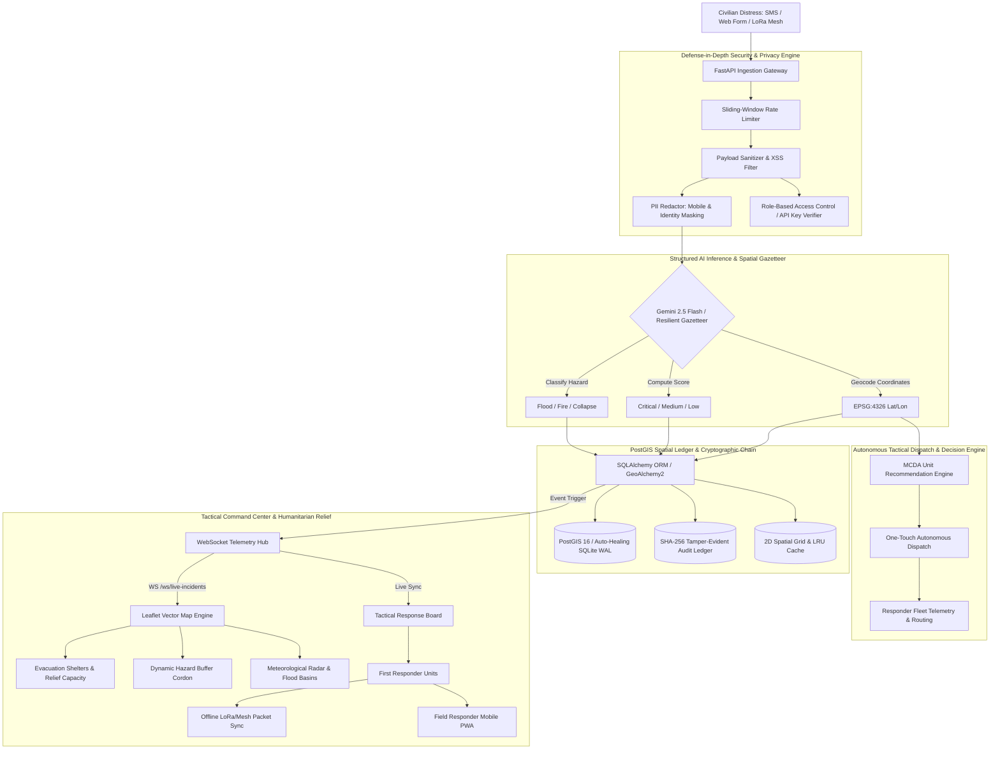

# u-SHA-jua | Sovereign Geospatial Disaster Informatics Platform

[](https://fastapi.tiangolo.com)
[](https://reactjs.org/)
[](https://www.typescriptlang.org/)
[](https://postgis.net/)
[](https://leafletjs.com/)
[](server/tests)
[](server/services/security.py)
[](LICENSE)

**u-SHA-jua** (*"You already know"* in Swahili) is an enterprise-grade, event-driven geospatial disaster informatics platform built for resilient emergency dispatch and crisis informatics under bandwidth-constrained conditions. Designed for informal settlements and flood/fire/collapse hazard corridors across Kenya and East Africa (Mathare, Kibera, Mukuru, Gikomba, Eastleigh, and the Nairobi Basin).

---

## 1. Full System Architecture



---

## 2. Key Capabilities & Tactical Modules

### 🛡️ Enterprise Security Hardening & Vulnerability Mitigation
- **Role-Based Access Control (RBAC)**: Enforces granular role authorizations (`ROLE_DISPATCHER`, `ROLE_RESPONDER`, `ROLE_ADMIN`) via secure `X-API-Key` headers on all mutating endpoints.
- **In-Memory Sliding-Window Rate Limiting**: Token-bucket algorithm enforcing strict per-IP rate limits (60 req/min for civilian reports, 300 req/min for telecom webhooks) to prevent DoS attacks and LLM budget exhaustion.
- **Automated PII Redaction (`mask_pii`)**: Automatically detects and masks civilian mobile numbers (`+254 7XX *** *XX`) prior to broadcasting live telemetry over WebSocket feeds.
- **Input Sanitization & Script Defenses**: HTML/script injection filtering, control character stripping, and strict length bounds (up to 4,000 characters) on all unstructured distress inputs.
- **Carrier-Grade Webhook Verification**: Shared secret validation (`X-Webhook-Secret`) preventing spoofing of incoming telecom SMS webhooks.
- **CORS Hardening**: Explicit origin controls eliminating dangerous wildcard credential configurations.

### ⚡ AI Multi-Criteria Decision Analysis (MCDA) Auto-Dispatch
- **Dynamic Unit Recommendation (`/api/v1/responders/recommend/{id}`)**: Evaluates unit specialty affinity (e.g., Water Rescue for Floods, Fire Engine for Fires, Ambulance for Collapse), Haversine road transit ETA, and distance.
- **One-Touch Autonomous Dispatch (`/api/v1/responders/auto-dispatch/{id}`)**: Executes automated assignment, triggers routing polylines, transitions unit status, and broadcasts operational events.
- **Live Fleet Tracking**: Real-time GPS location updates (`PATCH /api/v1/responders/{id}/location`) and status progression (Available -> Dispatched -> On Scene -> Returning).

### 🏛️ Designated Evacuation Shelters & Relief Capacity
- **Real-Time Facility Registry (`/api/v1/shelters`)**: Monitors total bed capacity, current occupancy, drinking water supply status, and medical post availability.
- **Nearest Operational Shelter Calculation (`/api/v1/shelters/nearest`)**: Calculates closest operational shelter with available bed space factoring live occupancy.
- **Live Occupancy Adjustment (`PATCH /api/v1/shelters/{id}/occupancy`)**: Dispatchers can update headcount in real-time, syncing immediately across all command views.

### 🌐 Dynamic Hazard Buffer Perimeters & Population Modeling
- **Circular Hazard Buffer Generation (`/api/v1/incidents/{id}/hazard-perimeter`)**: Computes 16-point circular polygon perimeters scaling with hazard type (Flood, Fire, Collapse) and urgency score (150m to 600m radius).
- **Population Impact Estimation**: Estimates affected civilian population based on informal settlement population densities.
- **Evacuation Corridor Advisories**: Dynamic visual safety cordons rendered directly on the Leaflet vector map.

### 🔒 Cryptographic SHA-256 Tamper-Evident Audit Ledger
- **Immutable Hash-Chained Audit Trail (`/api/v1/analytics/audit-log`)**: Records every incident report, dispatch order, status transition, and operator intervention with cryptographic hash linking.
- **One-Click Cryptographic Verification (`/api/v1/analytics/audit-log/verify`)**: Validates SHA-256 chain continuity from genesis block to current block for post-disaster humanitarian compliance.

### 📡 Offline Crisis Mesh Synchronization & Portable Bundles
- **Mesh Packet Ingestion (`/api/v1/incidents/sync/offline-packet`)**: Ingests distress reports collected during cellular blackouts via LoRa, Bluetooth, or ad-hoc Wi-Fi mesh relays.
- **Portable Crisis Bundle Export (`/api/v1/incidents/export/offline-bundle`)**: Exports a self-contained JSON snapshot containing active crises, fleet positions, shelters, and hazard perimeters for field tablets.

### 📱 Civilian Public Distress Portal
- **High-Accuracy Geolocation Lock**: Integrated HTML5 GPS geolocation capture with reverse geocoding fallback.
- **Situational Quick-Tags**: Instant reporting for critical conditions (Trapped, Rising Water, Medical Injury, Structural Crack, Electrical Hazard).
- **Multimedia Evidence Capture**: Simulated photo upload and in-browser voice note audio recording.
- **Live 4-Stage Rescue Tracking Timeline (`/api/v1/incidents/track/{id}`)**: Civilians track real-time response progress (Received -> Dispatched -> En Route -> Resolved) with assigned unit callsigns and estimated ETAs.

### 🚨 Field Responder Mobile PWA
- **Tactical Field Agent Interface**: Dedicated mobile viewport interface for field operatives.
- **Unit Selector & Mission Target**: Displays active mission brief, location landmarks, and civilian distress notes.
- **Turn-by-Turn Navigation Cues**: Step-by-step route guidance and distance-to-scene readouts.
- **Interactive On-Scene Checklist**: Rapid check-offs for scene safety, civilian triage, hazard isolation, and all-clear status.
- **One-Tap Status Progression**: Transitions unit between En Route, On Scene, and Resolved & Clear.

### 📊 Spatial Analytics & Heatmap Intelligence
- **Operational Metrics Dashboard (`/api/v1/analytics/summary`)**: Real-time calculation of Mean Time to Dispatch (MTTD), Mean Time to Resolution (MTTR), casualty estimates, and hotspot neighborhood rankings.
- **Urgency-Scaled Heatmap**: Dynamic Gaussian heat circles on Leaflet displaying spatial density of high-hazard zones.
- **Data Export Pipeline (`/api/v1/analytics/export/csv`)**: Complete incident history exportable in CSV format for humanitarian NGOs and disaster relief agencies.

### 🌧️ Early-Warning Weather & Flood Plain Radar
- **Meteorological Telemetry HUD (`/api/v1/weather/telemetry`)**: Real-time rainfall rate (mm/h), river gauge levels (m), barometric pressure, and flood advisory levels.
- **High-Hazard Flood Plain Polygons (`/api/v1/weather/flood-zones`)**: GeoJSON flood corridor boundaries for Mathare Valley, Kibera Ngong Corridor, Mukuru Basin, and Nairobi River Basin with designated evacuation muster points.

### 🗺️ Dynamic Multi-Basemap Engine
- **Multiple Cartographic Views**: Instant switching between CARTO Dark Matter (tactical night ops), CARTO Positron (high-contrast day ops), OpenStreetMap Standard, and Satellite Imagery.
- **Bandwidth Throttled Mode**: One-click low-bandwidth toggle disabling tile pre-fetching and heavy animations for 2G/3G connectivity.

### ⚡ High-Throughput & Resilient Infrastructure
- **In-Memory 2D SpatialGridIndex & LRU Cache**: Sub-millisecond GeoJSON spatial queries (`/api/v1/incidents/spatial-feed`) bypassing disk I/O under heavy load.
- **Gemini 2.5 Flash with Circuit Breaker**: Asynchronous AI extraction with 2.0s bounded timeout and fallback to an offline East African gazetteer with 60+ Kenyan settlement landmarks.
- **Carrier-Grade SMS Webhook**: Africa's Talking / Twilio compliant webhook (`/api/v1/sms/incoming`) maintaining <50ms carrier SLA.
- **Atomic Batch Ingestion**: High-throughput ingestion (`/api/v1/incidents/batch-report`) sustaining 400+ reports/sec for telecom aggregators.
- **Dual-Engine Persistence**: Seamless operation on PostgreSQL/PostGIS 16 for production and auto-healing SQLite WAL (Write-Ahead Logging) mode for zero-dependency local execution.

---

## 3. Directory Layout

```text
├── .antigravity/
│   └── config.yaml            # Antigravity CLI project config
├── docker-compose.yml         # PostGIS 16, FastAPI Backend, and Vite Frontend composition
├── PLAN.md                    # System implementation & phase blueprint
├── README.md                  # System overview, architecture, and documentation
├── scripts/
│   └── load_test.py           # Concurrency & latency percentile benchmark (50+ RPS)
├── server/                    # Python 3.10/3.11 FastAPI Backend
│   ├── config.py              # Environment configuration & security keys
│   ├── database.py            # PostGIS & auto-healing SQLite dual-mode DB engine
│   ├── main.py                # Application entrypoint, lifespan, & table seeding
│   ├── Dockerfile             # Backend container specification
│   ├── requirements.txt       # Python dependencies
│   ├── models/                # SQLAlchemy ORM models
│   │   ├── incident.py        # Incident entity with spatial coordinates & status enums
│   │   ├── responder.py       # First responder fleet units with coordinates & callsigns
│   │   └── shelter.py         # Emergency evacuation shelters with capacity & amenities
│   ├── schemas/               # Pydantic v2 validation & sanitization schemas
│   │   ├── incident.py        # Incident request/response schemas & GeoJSON types
│   │   └── responder.py       # Responder fleet schemas & dispatch payloads
│   ├── services/              # Core domain services & tactical modules
│   │   ├── audit_service.py   # SHA-256 Tamper-Evident Cryptographic Ledger
│   │   ├── nlp_service.py     # Gemini NLP with offline East African gazetteer fallback
│   │   ├── security.py        # RBAC, Rate Limiting, PII Redaction, Input Sanitization
│   │   ├── spatial_index.py   # 2D in-memory spatial grid index & LRU cache
│   │   └── websocket_manager.py # High-concurrency async WebSocket broadcast hub
│   ├── routers/               # Modular API endpoint routers
│   │   ├── analytics.py       # Metrics, CSV exports, & audit log verification
│   │   ├── incidents.py       # Ingestion, GeoJSON spatial feed, tracking, & hazard zones
│   │   ├── responders.py      # Fleet tracking, MCDA recommendation, & auto-dispatch
│   │   ├── shelters.py        # Evacuation shelter registry & nearest shelter search
│   │   ├── sms.py             # Telecom SMS webhooks (Africa's Talking / Twilio)
│   │   ├── weather.py         # Meteorological telemetry & flood risk polygons
│   │   └── ws.py              # Real-time WebSocket connection handling
│   └── tests/                 # Automated Pytest suite (28 comprehensive tests)
│       ├── test_features.py   # Tracking, weather telemetry, & flood polygons
│       ├── test_incidents.py  # Ingestion pipelines & spatial GeoJSON validation
│       ├── test_responders.py # Distance/ETA calculations & dispatch progression
│       ├── test_scaling.py    # In-memory spatial index, LRU cache, & batch ingestion
│       └── test_security_and_advanced.py # RBAC, rate limiter, PII, MCDA, & audit ledger
└── client/                    # Vite + React 18 + TypeScript + Leaflet Frontend
    ├── src/
    │   ├── components/        # Tactical UI & Operations Center Modals
    │   │   ├── AnalyticsModal.tsx      # Operational KPI metrics & CSV/GeoJSON export
    │   │   ├── CivilianPortalModal.tsx # Public distress reporting & live rescue tracker
    │   │   ├── CommandCenterModal.tsx  # Enterprise Command & Security Suite modal
    │   │   ├── DisasterMap.tsx         # Leaflet vector map, clusters, basemaps, & buffers
    │   │   ├── DispatchBoard.tsx       # Incident triage & one-touch dispatch controls
    │   │   ├── Header.tsx              # Telemetry bar, status badges, & navigation
    │   │   ├── ReportModal.tsx         # Quick incident reporting modal
    │   │   ├── ResponderFleet.tsx      # Fleet status bar & availability monitors
    │   │   ├── ResponderPwaModal.tsx   # Mobile PWA for field agents & scene checklist
    │   │   ├── SimulatorModal.tsx      # Crisis surge simulator console
    │   │   └── StatCards.tsx           # High-visibility operational HUD cards
    │   ├── services/          # REST & WebSocket API clients with auth headers
    │   │   └── api.ts         # Axios client, WebSocket subscriber, & API wrappers
    │   ├── types/             # TypeScript interfaces & GeoJSON definitions
    │   │   └── index.ts       # Shared data models, enums, & GeoJSON types
    │   ├── App.tsx            # Main tactical GIS operations viewport
    │   ├── index.css          # Tailwind CSS styling & animations
    │   └── main.tsx           # Application bootstrap
    ├── package.json           # Frontend dependencies
    └── Dockerfile             # Production Nginx container specification
```

---

## 4. Quickstart Guide

### Prerequisites
- Python 3.10 or 3.11
- Node.js 18+ and npm
- (Optional) Docker & Docker Compose for PostGIS 16

### 1. Environment Configuration
Create a `.env` file in the `server/` directory:
```env
PROJECT_NAME="u-SHA-jua Disaster Informatics Platform"
DATABASE_URL=sqlite:///./ushajua.db
ENVIRONMENT=development
HOST=127.0.0.1
PORT=8000

# Security & API Keys
ENFORCE_STRICT_AUTH=false
DISPATCHER_API_KEY=ushajua-dev-dispatcher-key
RESPONDER_API_KEY=ushajua-dev-responder-key
ADMIN_API_KEY=ushajua-dev-admin-key
SMS_WEBHOOK_SECRET=ushajua-telecom-secret

# External Services (Optional)
GEMINI_API_KEY=your_gemini_api_key_here
MAPBOX_ACCESS_TOKEN=your_mapbox_token_here
AFRICASTALKING_API_KEY=your_africastalking_key_here
AFRICASTALKING_USERNAME=sandbox
AFRICASTALKING_SENDER_ID=uSHAjua
```

### 2. Backend Setup (FastAPI)
```bash
cd server
pip install -r requirements.txt
python main.py
```
*API interactive Swagger documentation available at [http://localhost:8000/docs](http://localhost:8000/docs)*

### 3. Frontend Setup (React + Vite)
```bash
cd client
npm install
npm run dev
```
*Access the GIS Command Center at [http://localhost:5173](http://localhost:5173)*

### 4. Full-Stack Docker Compose (with PostGIS 16)
```bash
docker compose up -d --build
```

---

## 5. Comprehensive API Reference

| Method | Endpoint | Access Tier | Description |
|---|---|---|---|
| `POST` | `/api/v1/incidents/report` | Public (Rate-Limited) | Ingests civilian raw distress report, runs AI geocoding & broadcasts update |
| `POST` | `/api/v1/incidents/batch-report` | Public (Rate-Limited) | High-throughput batch ingestion for telecom aggregators (400+ reports/sec) |
| `POST` | `/api/v1/incidents` | Dispatcher / Admin | Creates structured incident directly |
| `GET` | `/api/v1/incidents` | Public | Lists paginated incidents with status and urgency filters |
| `GET` | `/api/v1/incidents/spatial-feed` | Public | GeoJSON FeatureCollection bounded by viewport with sub-millisecond LRU cache |
| `GET` | `/api/v1/incidents/cache-metrics` | Public | In-memory spatial grid and LRU cache hit/miss performance metrics |
| `GET` | `/api/v1/incidents/track/{id}` | Public | Civilian 4-stage rescue tracking timeline with assigned unit telemetry |
| `GET` | `/api/v1/incidents/{id}/hazard-perimeter` | Public | Dynamic circular hazard buffer polygon and affected population modeling |
| `POST` | `/api/v1/incidents/sync/offline-packet` | Public | Ingests offline mesh distress packets from field LoRa/Bluetooth nodes |
| `GET` | `/api/v1/incidents/export/offline-bundle` | Public | Exports portable JSON crisis bundle for disconnected field tablets |
| `GET` | `/api/v1/incidents/{id}` | Public | Retrieves specific incident details |
| `PATCH` | `/api/v1/incidents/{id}/status` | Dispatcher / Admin | Updates incident status (Pending -> Dispatched -> Resolved) |
| `DELETE` | `/api/v1/incidents/{id}` | Admin | Deletes incident record |
| `POST` | `/api/v1/sms/incoming` | Carrier Secret | Africa's Talking / Twilio incoming SMS webhook (<50ms carrier SLA) |
| `GET` | `/api/v1/sms/incoming` | Public | Webhook health verification probe |
| `GET` | `/api/v1/responders` | Public | Lists all first responder units with status, specialty, and live coordinates |
| `GET` | `/api/v1/responders/recommend/{id}` | Public / Dispatcher | AI MCDA scoring engine matching optimal responder units to crisis type |
| `POST` | `/api/v1/responders/auto-dispatch/{id}` | Dispatcher / Admin | One-touch autonomous dispatch execution |
| `POST` | `/api/v1/responders/{id}/dispatch` | Dispatcher / Admin | Dispatches specific responder unit and broadcasts synchronized routing |
| `PATCH` | `/api/v1/responders/{id}/status` | Responder / Admin | Updates responder operational status |
| `PATCH` | `/api/v1/responders/{id}/location` | Responder / Admin | Live field GPS coordinates update and telemetry broadcast |
| `POST` | `/api/v1/responders/surge-simulate` | Dispatcher / Admin | Triggers synthetic emergency surge dispatch simulation |
| `GET` | `/api/v1/shelters` | Public | Lists all designated emergency evacuation shelters with capacity status |
| `GET` | `/api/v1/shelters/nearest` | Public | Calculates closest operational shelter with available bed space |
| `PATCH` | `/api/v1/shelters/{id}/occupancy` | Dispatcher / Admin | Updates real-time shelter occupancy count |
| `GET` | `/api/v1/weather/telemetry` | Public | Meteorological HUD: rainfall rate, river gauge level, storm alert |
| `GET` | `/api/v1/weather/flood-zones` | Public | High-hazard flood plain GeoJSON polygons with evacuation muster points |
| `GET` | `/api/v1/analytics/summary` | Public | Operational KPI metrics: MTTD, MTTR, casualty estimates, hotspot ranking |
| `GET` | `/api/v1/analytics/export/csv` | Dispatcher / Admin | Downloads historical incident dataset in CSV format |
| `GET` | `/api/v1/analytics/audit-log` | Dispatcher / Admin | Retrieves immutable SHA-256 operational event audit trail |
| `GET` | `/api/v1/analytics/audit-log/verify` | Dispatcher / Admin | Validates cryptographic integrity across all historical audit blocks |
| `WS` | `/ws/live-incidents` | Public | Real-time WebSocket event stream with channel subscriptions |
| `GET` | `/health` | Public | System health check reporting active connections and audit verification |

---

## 6. Verification & Automated Test Suite

The platform includes 28 automated integration and security unit tests with a 100% pass rate:

```bash
cd server
pytest -v
```

### Verified Test Modules:
- `tests/test_security_and_advanced.py`: Rate limiting, PII masking, input sanitization, SHA-256 audit ledger integrity, shelters API, MCDA recommendation, hazard perimeters, and offline mesh sync.
- `tests/test_features.py`: Civilian distress tracking, weather telemetry, and flood polygon endpoints.
- `tests/test_incidents.py`: Ingestion pipelines, coordinate bounds, and spatial GeoJSON format.
- `tests/test_responders.py`: Distance/ETA calculations, dispatch synchronization, and status progression.
- `tests/test_scaling.py`: Concurrency scaling, spatial grid indexing, and LRU cache hit rate.

### High-Concurrency Benchmark
To simulate high-throughput emergency distress traffic (50+ concurrent requests/second):
```bash
python scripts/load_test.py
```
Outputs latency percentiles (`p50`, `p95`, `p99`), throughput rate, and database commit times.

---

## 7. Security Best Practices
- **Strict Auth Toggle**: Set `ENFORCE_STRICT_AUTH=true` in production to enforce `X-API-Key` headers on all mutating endpoints.
- **Telecom Gateway**: Always set `SMS_WEBHOOK_SECRET` in production to ensure webhooks originate exclusively from verified telco gateways.
- **Audit Verification**: Run `/api/v1/analytics/audit-log/verify` periodically to detect any tampering attempts in the incident ledger.

---

## 8. License
Apache License 2.0. Built for sovereign humanitarian crisis resilience and community disaster informatics.
