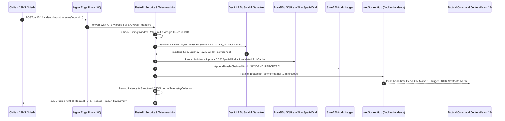
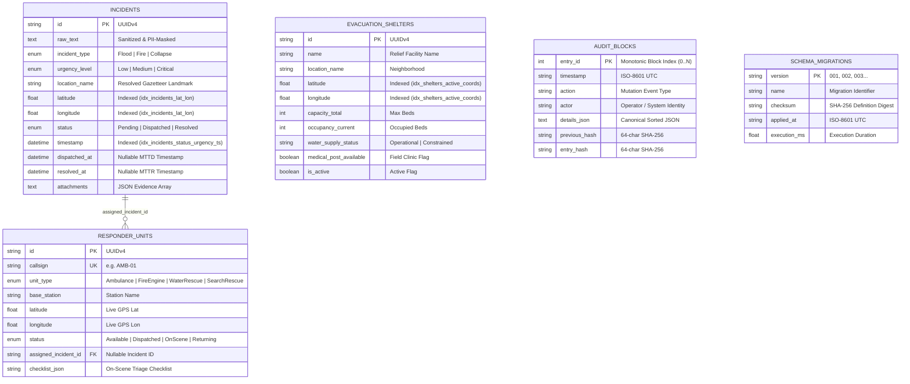

# u-SHA-jua (`v1.4.0-enterprise`) — Architecture, Dataflow & Operational Runbooks

This document provides the deep system architecture, sequence workflows, environment configuration catalog, and step-by-step **Standard Operating Procedures (SOPs) / Runbooks** for operating **u-SHA-jua** in production crisis deployments.

---

## 1. End-to-End Request & Telemetry Lifecycle



---

## 2. Database Schema & Composite B-Tree Indexing Architecture



---

## 3. Standard Operating Procedures (Operational Runbooks)

### Runbook 1: Emergency Database Snapshot Backup & SHA-256 Transactional Restore
**When to use**: Before major infrastructure maintenance, before migrating between SQLite WAL and PostgreSQL/PostGIS, or to recover from accidental operator data deletion.

1. **Export a Cryptographically Sealed Snapshot**:
   ```bash
   curl -fsS http://localhost:8000/api/v1/admin/backup/snapshot -o ushajua_snapshot.json
   ```
   - Inspect the `sha256_checksum` and `record_counts` (`incidents`, `responder_units`, `evacuation_shelters`) in `ushajua_snapshot.json`.
   - Confirm that block `DATABASE_SNAPSHOT_EXPORTED` was appended to `/api/v1/analytics/audit-log`.

2. **Restore a Snapshot Transactionally**:
   ```bash
   curl -X POST http://localhost:8000/api/v1/admin/backup/restore \
     -H "Content-Type: application/json" \
     --data-binary @ushajua_snapshot.json
   ```
   - **Important**: Always use `--data-binary @file.json` so whitespace and floating-point formatting remain untouched. If the payload is modified in transit, the backend rejects the restore with `HTTP 400 Bad Request` (`Snapshot SHA-256 integrity check failed`).
   - Upon success (`200 OK`), all tables are upserted transactionally, the in-memory `SpatialGridIndex` is synchronized, and `SpatialLRUCache` is invalidated.

---

### Runbook 2: Schema Migration Verification & Query Plan Inspection
**When to use**: After deploying a new release or diagnosing slow database queries.

1. **Check Applied Migrations & Active Indexes**:
   ```bash
   curl -fsS http://localhost:8000/api/v1/admin/migrations
   ```
   - Verify `"head_version": "003"` and confirm that `idx_incidents_lat_lon`, `idx_incidents_status_urgency_ts`, `idx_responders_status_type`, and `idx_shelters_active_coords` appear in `active_indexes`.

2. **Trigger Idempotent Migration Runner Manually**:
   ```bash
   curl -X POST http://localhost:8000/api/v1/admin/migrations/run
   ```

3. **Verify Zero Full-Table Scans via `EXPLAIN QUERY PLAN`**:
   ```bash
   curl -fsS http://localhost:8000/api/v1/admin/query-plan
   ```
   - Confirm `"all_queries_indexed": true`.

---

### Runbook 3: Rate-Limit Triage, Abuse Mitigation & Strict Auth Lockdown
**When to use**: During a DDoS/botnet flood against public reporting endpoints or when transitioning from staging to sovereign production lockdown.

1. **Inspect Rate-Limit Counters**:
   ```bash
   curl -fsS http://localhost:8000/api/v1/telemetry/metrics
   ```
   - Check `requests.rate_limited_429` and `top_routes`.
   - Default Sliding-Window Tiers:
     - `auth` (`/api/v1/auth/login`, `/register`): **10 req / 60s** per IP
     - `sms_webhook` (`/api/v1/sms/incoming`): **30 req / 60s** per IP
     - `incident_creation` (`POST /api/v1/incidents*`): **30 req / 60s** per IP
     - `general`: **300 req / 60s** per IP

2. **Enable Strict RBAC & JWT Lockdown**:
   - In `server/.env` or `docker-compose.yml`, set:
     ```env
     ENVIRONMENT=production
     ENFORCE_STRICT_AUTH=true
     DISPATCHER_API_KEY=<strong-random-key>
     RESPONDER_API_KEY=<strong-random-key>
     ADMIN_API_KEY=<strong-random-key>
     SMS_WEBHOOK_SECRET=<carrier-hmac-secret>
     ```
   - Verify lockdown status via `GET /health` -> `"security_mode": "strict"`.

---

### Runbook 4: Real-Time Observability, Structured Log Correlation & Client Crash Triage
**When to use**: Investigating `5xx` server errors, high P95 latency spikes, or frontend React rendering exceptions in the field.

1. **Inspect Live Latency Percentiles & Subsystem Gauges**:
   ```bash
   curl -fsS http://localhost:8000/api/v1/telemetry/metrics
   ```
   - Check `latency_ms.avg`, `latency_ms.p95`, `latency_ms.max`, `subsystems.spatial_cache_hits`, and `subsystems.active_ws_connections`.

2. **Trace Specific Requests by `X-Request-ID`**:
   ```bash
   curl -fsS "http://localhost:8000/api/v1/telemetry/logs?limit=50"
   ```
   - Every response (including `404`, `422`, `429`, and `500` unified error envelopes) returns an `X-Request-ID` header and `request_id` JSON property that maps directly to the structured JSON log buffer.

3. **Inspect Client-Side React `ErrorBoundary` Crash Reports**:
   ```bash
   curl -fsS "http://localhost:8000/api/v1/telemetry/client-errors?limit=25"
   ```
   - Whenever a browser encounters an unhandled component exception, `ErrorBoundary.tsx` isolates the crash, saves `sessionStorage['ushajua_last_crash']`, offers one-click **Recover Tactical View**, and POSTs the stack trace to `/api/v1/telemetry/client-error` (logged as `CLIENT_CRASH_REPORTED` in the SHA-256 audit ledger).

---

### Runbook 5: Offline PWA Service Worker & LoRa Mesh Synchronization
**When to use**: Operating field tablets in flood/collapse zones with degraded or severed 2G/3G cellular connectivity.

1. **Export Portable Crisis Bundle Before Entering Blackout Zone**:
   ```bash
   curl -fsS http://localhost:8000/api/v1/incidents/export/offline-bundle -o crisis_bundle.json
   ```
2. **Synchronize Field Mesh Packets Upon Reconnection**:
   - The browser PWA (`client/public/sw.js` + `localStorage` outbox) automatically queues civilian distress reports while offline and flushes them via `POST /api/v1/incidents/sync/offline-packet` when connectivity returns, deduplicating by UUID.
